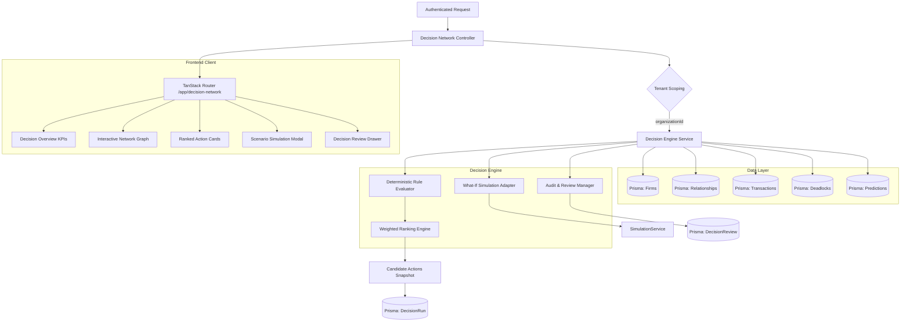

# NEXUS-CFR — Decision Network Architecture & Implementation

## 1. Executive Overview

The **Decision Network** is an explainable decision-support system in NEXUS-CFR that synthesizes financial risk analysis, counterparty transaction history, network graph dependencies, predictive risk scores, and what-if simulations into a unified decision workflow.

It directly answers four core operational questions:
1. **Which SME, buyer, supplier, or dependency requires attention?** (Identified through composite risk scoring, exposure thresholds, payment delays, and network centrality).
2. **Why is it risky, and what evidence supports that assessment?** (Transparent evidence references, observed ledger metrics, overdue transaction counts, and threshold crossings).
3. **Which practical actions could reduce the risk?** (Ranked candidate interventions derived algorithmically from empirical preconditions).
4. **What are the estimated consequences of each action compared with the current situation?** (Quantitative what-if cascade simulation comparing baseline vs post-intervention expected loss, cascade spread probability, and recovery timelines).

---

## 2. System Architecture



---

## 3. Core Modules & Files

### Backend Modules
- **Repository (`server/src/repositories/decisionNetwork.repository.ts`):** 
  Organization-scoped data access for `DecisionRun`, `CandidateAction`, and `DecisionReview` entities.
- **Service (`server/src/services/decisionEngine.service.ts`):** 
  Deterministic action evaluation, evidence binding, weighted ranking, what-if cascade simulation adapter, and RBAC review logic.
- **Controller (`server/src/controllers/decisionNetwork.controller.ts`):** 
  HTTP handlers with parameter validation, tenant resolution, and typed error responses.
- **Routes (`server/src/routes/decisionNetwork.routes.ts`):** 
  Express routes with `authenticate` and `authorize("SME_ADMIN", "ANALYST")` middleware.
- **Database Schema (`server/prisma/schema.prisma`):** 
  Prisma models for `DecisionRun`, `CandidateAction`, and `DecisionReview`.

### Frontend Modules
- **Route (`src/routes/app.decision-network.tsx`):** 
  TanStack Router file route definition at `/app/decision-network`.
- **Page Component (`src/components/pages/DecisionNetworkPage.tsx`):** 
  Production decision-support UI including KPI cards, interactive SVG topology graph, ranked intervention list, node-level evidence inspection, what-if comparison dialog, and review submission modal.
- **Navigation (`src/layouts/AppLayout.tsx`):** 
  Sidebar navigation integration across all user roles (`SME_ADMIN`, `ANALYST`, `VIEWER`).
- **API Contracts & Client (`src/api/contracts.ts`, `src/services/decisionServices.ts`):** 
  REST client bindings communicating directly with the Express backend.
- **TypeScript Types (`src/types/decisionNetwork.ts`):** 
  Typed interfaces mirroring backend contracts.

---

## 4. API Specification

| Endpoint | Method | Auth / Role | Description |
| :--- | :--- | :--- | :--- |
| `/api/decision-network` | `GET` | Authenticated | Retrieves organization network topology, summary KPIs, candidate actions, and recent reviews. |
| `/api/decision-network/nodes/:firmId` | `GET` | Authenticated | Retrieves deep decision context for a selected firm (connected counterparties, transactions, predictions, actions). |
| `/api/decision-network/runs` | `POST` | `SME_ADMIN`, `ANALYST` | Triggers a fresh deterministic decision evaluation run. |
| `/api/decision-network/runs/:runId` | `GET` | Authenticated | Retrieves results and parameters for a specific evaluation run. |
| `/api/decision-network/runs/:runId/simulate` | `POST` | Authenticated | Executes what-if cascade simulation for a candidate action on an isolated in-memory network copy. |
| `/api/decision-network/options/:optionId/review` | `POST` | `SME_ADMIN`, `ANALYST` | Records a formal human review decision (`APPROVED`, `REJECTED`, `DEFERRED`) with reason notes. |

---

## 5. Candidate Action Generation Rules

The engine applies deterministic rules evaluated against authorized ledger and counterparty data:

| Action Type | Preconditions | Trigger Thresholds | Evidence Tracked |
| :--- | :--- | :--- | :--- |
| **`COLLECTION_PRIORITIZATION`** | Overdue receivables exist for counterparty | `paymentDelayDays > 0` or status in `[DELAYED, CRITICAL]` | Overdue invoice count, overdue amount (₹), maximum delay days. |
| **`DELAYED_PAYMENT_FOLLOWUP`** | Buyer counterparty demonstrates recurring settlement delays | `avgPaymentDelayDays > 25` and `transactionCount >= 2` | Historical delay average, total pending invoice value. |
| **`ALTERNATE_SUPPLIER`** | Single-source dependency on primary vendor | `suppliersCount === 1` or single incoming relationship | Suppliers count, dependency weight percentage (> 70%). |
| **`INVENTORY_BUFFER`** | Critical dependency with compressed liquidity buffer | `cashBufferDays < 25` and `riskScore >= 45` | Cash buffer days, composite risk score. |
| **`DEADLOCK_INVESTIGATION`** | Circular payment deadlock detected in topology | Multi-party circular chain present in `Deadlock` table | Circular path (`A -> B -> C -> A`), deadlock exposure (₹). |
| **`TRANSACTION_RISK_REVIEW`** | Elevated financial stress and high composite default risk | `riskScore >= 60` or `financialStress > 0.6` | Composite risk score, financial stress ratio, outstanding exposure. |

*Evidence Suppression:* If preconditions are unsatisfied (e.g. no overdue receivables or diversified supplier base), the respective action type is suppressed.

---

## 6. Action Ranking Formula & Configurable Weights

Candidate actions are ranked using a normalized composite score:

$$\text{actionScore} = w_{\text{benefit}} \times \text{benefit} + w_{\text{urgency}} \times \text{urgency} + w_{\text{feasibility}} \times \text{feasibility} + w_{\text{confidence}} \times \text{confidence}$$

### Configured Default Weights:
- **$w_{\text{benefit}} = 0.35$** (Expected risk reduction or financial recovery)
- **$w_{\text{urgency}} = 0.30$** (Imminence of default, overdue days, or buffer depletion)
- **$w_{\text{feasibility}} = 0.20$** (Operational ease of execution)
- **$w_{\text{confidence}} = 0.15$** (Empirical reliability of supporting data)
- **Constraint:** $\sum w_i = 1.0$ (Strict validation enforced by `DecisionEngineService.calculateActionScore`).

All component scores are normalized to a $[0, 100]$ scale. The output $\text{actionScore}$ is bounded $[0, 100]$.

---

## 7. What-If Scenario Simulation Integration

For supported candidate actions:
1. **Isolated Copy:** Simulation runs on an in-memory deep copy of the network graph.
2. **Baseline State:** Captures current expected loss, cascade spread probability, potential defaults, and recovery days.
3. **Intervention State:** Applies mitigated parameters (e.g., accelerated recovery rate $+30\%$, delay reduction $-60\%$, exposure recovery $-60\%$).
4. **Comparison Metrics:** Computes absolute and percentage reduction in expected loss and cascade probability.
5. **Ledger Immutability Guarantee:** Financial transactions, firms, and relationships in the database remain 100% unaltered.

### Supported vs. Non-Simulatable Actions:
- **Simulatable:** `COLLECTION_PRIORITIZATION`, `INVENTORY_BUFFER`, `TRANSACTION_RISK_REVIEW`, `DELAYED_PAYMENT_FOLLOWUP`, `DEADLOCK_INVESTIGATION`.
- **Marked Non-Simulatable (`isSimulatable: false`):** `ALTERNATE_SUPPLIER`. Sourcing alternative suppliers involves external procurement qualification; quantitative cascade shock propagation cannot be simulated until the specific replacement vendor's operational parameters are ingested.

---

## 8. Role Permissions & Multi-Tenant Isolation

### Role-Based Access Control (RBAC):
- **`SME_ADMIN`**: Full access to view, re-evaluate, simulate, and record review decisions.
- **`ANALYST`**: Full access to view, re-evaluate, simulate, and record review decisions.
- **`VIEWER`**: Read-only access. Can inspect graph, view actions, and run scenario simulations, but **strictly forbidden from submitting reviews** (receives HTTP 403 Forbidden on the backend; UI disables review buttons with explanatory badge).

### Multi-Tenant Security:
- All database queries and mutations require `organizationId` matching the verified JWT token.
- Cross-tenant identifiers passed in URLs or payloads return `404 Not Found` or empty sets.
- Newly created empty organizations display genuine empty states with zero leakage of demo data.

---

## 9. Verification & Automated Test Results

The feature was validated with an end-to-end automated test suite: `server/tests/decision_network_complete.test.ts`.

### Test Suite Execution:
```
✓ tests/decision_network_complete.test.ts (18 tests) 61073ms
  ✓ 1. Authenticated access to Decision Network overview returns valid structure
  ✓ 2. Correct graph construction from authorized records
  ✓ 3. Empty-organization behavior displays genuine empty states without fabrication
  ✓ 4. Candidate action generation for overdue invoices creates COLLECTION_PRIORITIZATION
  ✓ 5. Candidate action generation for supported dependency risks creates ALTERNATE_SUPPLIER or INVENTORY_BUFFER
  ✓ 6. Suppression of actions when required evidence is missing
  ✓ 7. Correct action score normalization and weight validation
  ✓ 8. Baseline-versus-scenario calculation on simulatable action
  ✓ 9. Unsupported simulation handling gracefully returns isSimulatable: false
  ✓ 10. Decision review workflow: approve, reject, and defer
  ✓ 11. Input validation and invalid IDs reject with appropriate status codes
  ✓ 12. Cross-tenant graph and node context rejection
  ✓ 13. Cross-tenant decision-run access rejection
  ✓ 14. Cross-tenant simulation and review rejection
  ✓ 15. Viewer permission enforcement: VIEWER cannot submit reviews
  ✓ 16. Audit history creation: DecisionReview persisted and linked to action
  ✓ 17. Idempotent evaluation behavior: createRun generates valid bounded set
  ✓ 18. Ledger preservation: simulations do NOT mutate financial transactions or firms

Test Files  1 passed (1)
     Tests  18 passed (18)
```

### Type Checking & Production Build:
- **Server:** `npx tsc --noEmit` — 0 errors (clean compilation).
- **Frontend:** `npx tsc --noEmit` — 0 errors (clean compilation).
- **Production Bundle:** `npm run build` — Built successfully in 14.08s with Nitro SSR server output (`.output/server/_ssr/app.decision-network-QdOw7Y7E.mjs`).
