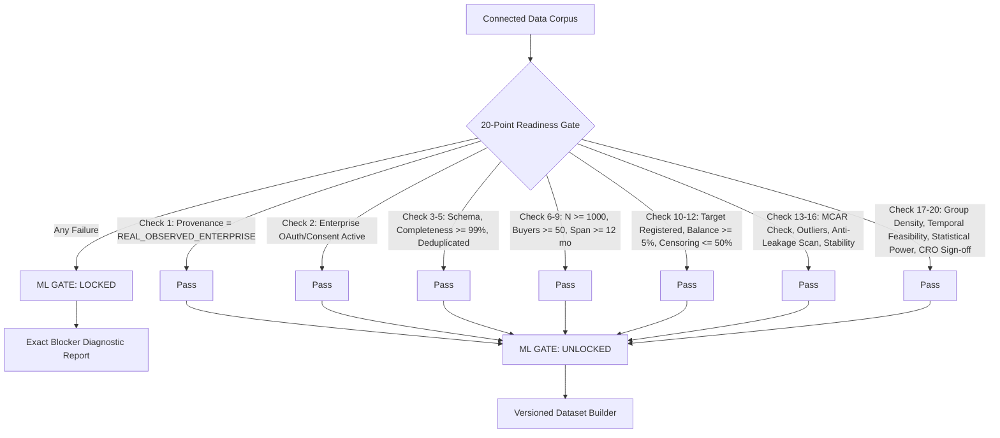

# NEXUS-CFR Phase 4: Production ML Foundation Architecture

**System:** NEXUS-CFR — SME Financial Risk & Supply Chain Resilience  
**Tagline:** *“Predict financial risk before it becomes a supply-chain crisis.”*  
**Phase:** 4 — Authorized Primary Data → ML Readiness → Leakage-Safe Modeling → Validation → Explainability → Model Governance → Production ML Readiness  
**Core Governance Axiom:** Real models require authorized genuine enterprise transaction ledgers. Zero fabrication. Zero fake metrics. Zero fake training results. Zero synthetic data promotion.

---

## 1. System Status & Foundational Truth

```
Phase 3.9: ENTERPRISE CONNECTOR INGESTION COMPLETE
  - TallyPrime, Zoho Books, QuickBooks Online, SAP S/4HANA, TReDS Sandbox, Controlled File Export
  - CanonicalInvoiceContract v3.9
  - Cryptographic tenant isolation & masked credential protection
  - 119/119 Vitest test cases passing

CURRENT SYSTEM TRUTH:
  - Current portfolio (ORG-003, N=50) is an ARCHITECTURAL BENCHMARK / SIMULATED DATASET.
  - ML TRAINING REMAINS OBJECTIVELY LOCKED.
  - No fake metrics (AUC, PR-AUC, F1, RMSE, SHAP, Accuracy) are manufactured or presented as production truths.
  - The Phase 4 ML architecture is completely built, verified, and ready to automatically execute when authorized enterprise transactions arrive.
```

---

## 2. Prediction Targets & Problem Formulation

All prediction targets are formally registered in `TARGET_REGISTRY` with unambiguous mathematical definitions, inclusion/exclusion criteria, and censoring treatments:

| Target ID | Problem Type | Prediction Anchor ($t_0$) | Horizon | Formula | Censoring Strategy | Minimum Scale Requirements |
| :--- | :--- | :--- | :--- | :--- | :--- | :--- |
| **PAYMENT_DELAY_RISK** | Binary Classification | Invoice Issuance ($t_0$) | 90 days | $y = \mathbb{I}(\text{paymentDate} > \text{dueDate})$ | Exclude open unexpired invoices | $N \ge 1,000$ settled, $\ge 50$ buyers, $\ge 100$ positives, $\ge 12$ months |
| **PAYMENT_DELAY_SEVERITY** | Continuous Regression | Invoice Issuance ($t_0$) | 180 days | $y = \max(0, \lfloor(\text{paymentDate} - \text{dueDate})/86400\rfloor)$ | Completed lifecycles only | $N \ge 1,000$ settled, $\ge 50$ buyers, $\ge 12$ months |
| **SEVERE_DELINQUENCY_RISK** | Binary Classification | Invoice Issuance ($t_0$) | 180 days | $y = \mathbb{I}(\text{DPD} \ge 90 \lor \text{default} = 1)$ | Exclude invoices with $<90$ days post-due follow-up | $N \ge 2,500$ settled, $\ge 100$ buyers, $\ge 50$ defaults, $\ge 24$ months |
| **SME_FINANCIAL_STRESS** | Binary Classification | Observation Epoch | 90 days | $y = \mathbb{I}(\frac{\text{Overdue}}{\text{Billing}} > 0.40 \lor \Delta\text{DSO} > 50\%)$ | Rolling observation window | $N \ge 500$ observations, $\ge 30$ buyers, $\ge 40$ stress events, $\ge 18$ months |

---

## 3. 20-Point Objective ML Readiness Gate

The ML Readiness Gate (`MLReadinessGate.evaluateDataset`) evaluates 20 independent criteria. If **any** mandatory check fails, ML is strictly marked **`LOCKED`** with explicit remediation instructions.



---

## 4. Anti-Leakage & Feature Eligibility Framework

Features are categorized into strict eligibility classes (`AntiLeakageAuditor`):
1. **`SAFE_PRE_PREDICTION`**: Unconditionally known at invoice issuance $t_0$:
   - `invoiceAmount`: Gross total amount (INR).
   - `creditPeriodDays`: Contractual terms: $\lfloor(\text{dueDate} - \text{invoiceDate})/86400000\rfloor$.
   - `invoiceDayOfWeek`, `invoiceMonthOfYear`: Seasonality and calendar effects.
2. **`CONDITIONAL_HISTORICAL`**: Aggregations computed using **only** events where $\text{eventTime} < t_0$:
   - `buyerHistoricalDelayMean30d`: Trailing 30-day clearing delay of buyer's historical settlements.
   - `buyerHistoricalDelayMean90d`: Trailing 90-day clearing delay.
   - `buyerOverdueRatioPreT0`: Ratio of buyer's settled invoices that cleared late prior to $t_0$.
   - `buyerSettledCountPreT0`: Historical density of transactions for counterparty.
   - `supplierTrailingVolume90d`: Supplier billing volume in trailing 90 days prior to $t_0$.
   - `supplierOverdueReceivableExposurePreT0`: Open unpaid overdue receivables owed to supplier as of $t_0$.
   - `amountRelativeToBuyerAvg`: Ratio of invoice amount to buyer's historical average ticket size.
   - `networkBuyerInDegreePreT0`: Number of active supplier ties serving buyer prior to $t_0$.
   - `networkSupplierConcentrationPreT0`: Herfindahl-Hirschman index (HHI) of supplier across buyers.
3. **`POST_OUTCOME_FORBIDDEN`**: **Fatal Leakage** (Automatically scanned and purged):
   - `paymentDate`, `paymentDelayDays`, `actualPaymentStatus`, `settledAmount`, `clearingReference`, `postDueOutstandingAmount`.

---

## 5. Temporal Data Partitioning

Random K-fold CV and random train/test splits are strictly prohibited for financial trade credit. The system enforces out-of-time chronological partitioning:

$$\max(t_{\text{train}}) \le \min(t_{\text{val}}) \le \max(t_{\text{val}}) \le \min(t_{\text{test}})$$

```
Historical Origin ───────────────> Chronological Progression ───────────────> Future
[    Training Window (60%)    ] [   Validation Window (20%)   ] [  Out-of-Time Test (20%)  ]
```

- Zero look-ahead bias: The model is evaluated on future market conditions it has never seen.
- Walk-forward backtesting: Expanding-window backtesting evaluates stability across multiple temporal folds.

---

## 6. Tiered Modeling & Calibration Strategy

```
           Candidate Architectures
                      │
     ┌────────────────┴────────────────┐
     ▼                                 ▼
Baseline Regularized            Interpretable Non-linear
Logistic Classifier (L2)         Decision Forest (Stump Bagging)
     │                                 │
     └────────────────┬────────────────┘
                      ▼
            Probability Calibration
             (Platt Sigmoid Scaling)
                      │
                      ▼
             Reliability Diagram
         (Expected Calibration Error)
```

1. **Tier 1 — Interpretable Baseline**: Regularized Logistic Regression with L2 ridge penalty and feature standardization.
2. **Tier 2 — Non-Linear Interaction**: Bagged Decision Forest stumps capturing threshold effects without black-box complexity.
3. **Tier 3 — Duration Regression**: L2-regularized Ridge Regression estimating delay days.
4. **Probability Calibration**: Platt scaling optimizes sigmoid parameters $(A, B)$ on validation margins. Calibrated only when validation $N \ge 100$ to prevent secondary overfitting.

---

## 7. Model Governance & Tenant Isolation

1. **Multi-Tenant Model Registry**:
   - Model artifacts, datasets, feature snapshots, and metrics are strictly partitioned by `organizationId`.
   - Organization A can never inspect, transition, or execute Organization B's models.
2. **Immutable Artifact Checksum**:
   - Every model artifact stores a cryptographic SHA-256 checksum over its hyperparameters, dataset ID, feature version, and evaluation metrics.
3. **Governed Lifecycle States**:
   $$\text{EXPERIMENTAL} \longrightarrow \text{VALIDATED} \longrightarrow \text{APPROVED} \longrightarrow \text{DEPLOYED} \longrightarrow \text{MONITORED} \longrightarrow \text{RETIRED}$$
   - Only `ADMIN` or `SME_ADMIN` can transition a model to `APPROVED`.
   - An unapproved model cannot be deployed or serve production predictions.

---

## 8. Network + ML Integration Architecture

```
[ Individual Invoice ML Predictions ]
                  │
                  ▼
[ Counterparty Firm-Level Exposure Aggregation ]
  (Receivables at risk, Payables obligations, Exposure-weighted delay probability)
                  │
                  ▼
[ Buyer-Supplier Directed Graph Topology ]
  (Dependency ties, Working-capital buffers, Sub-tier supplier relationships)
                  │
                  ▼
[ Exogenous Shock Vector Construction ]
  (Initial default probability, Transmission rate, Liquidity deficit magnitude)
                  │
                  ▼
[ Cascade Simulation & Optimization Engines ]
  (Monte Carlo liquidity shortfall propagation & Constrained invoice discounting)
```

**Clean Separation of Concerns**:
- **ML Layer**: *"What is the estimated default or delay probability of this transaction?"*
- **Graph Layer**: *"Who depends on whom in the supply network?"*
- **Simulation Layer**: *"What happens to liquidity across nodes if this shock propagates?"*
- **Optimization Layer**: *"Which constrained liquidity intervention minimizes network systemic loss?"*

---

## 9. Drift & Production Monitoring

- **Population Stability Index (PSI)**: Evaluated per feature against training baseline:
  - $\text{PSI} < 0.10$: Stable distribution (`NO_DRIFT`).
  - $0.10 \le \text{PSI} < 0.25$: Moderate shift (`MODERATE_DRIFT`).
  - $\text{PSI} \ge 0.25$: Significant population drift (`SIGNIFICANT_DRIFT` $\to$ trigger retraining alert).
- **Delayed Outcome Performance**: Marked `PENDING_OUTCOMES` until invoice credit windows expire, preventing premature or biased performance claims.
