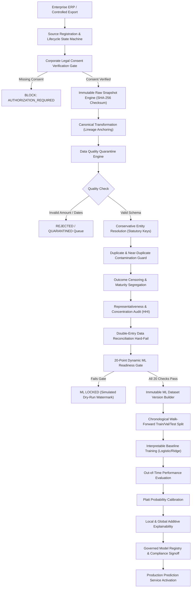

# NEXUS-CFR — PHASE 6 ARCHITECTURAL SPECIFICATION
## REAL DATA ACTIVATION, EVIDENCE-BASED ML UNLOCK & PRODUCTION READINESS

---

## 1. Architectural Mission & Absolute Truth Axiom

Phase 6 hardens NEXUS-CFR's primary enterprise data acquisition architecture, moving the system from:
> *"ML infrastructure READY but no authorized primary data"*  

to:
> *"Authorized primary enterprise data can actually enter the system, be proven authentic, pass governance, automatically satisfy or fail readiness gates, and — only if all requirements are genuinely satisfied — activate real ML training."*

### Absolute Non-Negotiable Principle
**TRUTH > COMPLETENESS > DEMO APPEARANCE.**
- NEXUS-CFR never fabricates corporate counterparties, accounting invoices, ERP connections, or legal consent.
- Benchmark or synthetic data is strictly prohibited from upgrading to `REAL_OBSERVED_ENTERPRISE`.
- The production prediction gate remains firmly locked until qualifying primary data passes all 20 objective criteria.

---

## 2. End-to-End Primary Ingestion Lifecycle



---

## 3. Hardened Production Prediction Safety & Fallback Behavior

### Failure-First Prediction Policy
If an inference request is dispatched to `/api/ml/predict` when no production-approved model is deployed for the organization:
1. **Default Mode:** Throws typed `MLUnavailableError` returning structured HTTP 422:
   ```json
   {
     "success": false,
     "status": "ML_UNAVAILABLE",
     "code": "NO_APPROVED_MODEL",
     "error": "Production ML Locked: No APPROVED and DEPLOYED model found for organization 'ORG-003' and target 'PAYMENT_DELAY_RISK'.",
     "isModelPrediction": false,
     "inferenceType": "NON_ML_FALLBACK",
     "governanceNotice": "NOT_FOR_PRODUCTION_DECISIONING"
   }
   ```
2. **Controlled UI Fallback Mode (`allowFallback: true`):**
   Returns an explicit, unmistakable fallback object:
   - `isModelPrediction: false`
   - `inferenceType: "NON_ML_FALLBACK"`
   - `warningLabel: "NOT_A_MODEL_PREDICTION"`
   - `policyNotice: "NOT_FOR_PRODUCTION_DECISIONING"`
   - `disclaimer`: Strict notice that heuristic metrics cannot be used for credit decisioning.

---

## 4. Controlled Enterprise File Ingestion (First-Class Production Path)

Because commercial enterprises often prefer providing cryptographically signed CSV or Excel exports rather than direct ERP API access, Phase 6 promotes controlled file ingestion to a first-class production route via `ControlledFileIngestionService`:

- **Endpoint:** `POST /api/connectors/controlled-file/ingest`
- **Mandatory Fields:**
  - `filename`: Source export filename
  - `rawPayload`: CSV text or JSON record array
  - `corporateEntityName`: Legal entity name
  - `authorizedSignatoryName`: Corporate officer (e.g. CFO, Controller)
  - `signatoryTitle`: Corporate title
  - `legalConsentReferenceId`: Unique legal authorization reference
  - `provenance`: `REAL_OBSERVED_ENTERPRISE` or `SIMULATED_BENCHMARK`
- **Pipeline Execution:** Computes file SHA-256 and schema fingerprint, validates consent, normalizes to canonical ledger, partitions quarantine records, checks entity resolution, and evaluates the 20-point ML gate.

---

## 5. Enterprise Audit Logging Architecture

All compliance-critical lifecycle transitions are recorded in `AuditLogService` with append-only, tenant-isolated storage:
- `SOURCE_REGISTERED`
- `AUTHORIZATION_SUBMITTED`, `AUTHORIZATION_APPROVED`, `AUTHORIZATION_REJECTED`
- `CONNECTION_TESTED`, `EXTRACTION_FAILED`
- `SNAPSHOT_CREATED`
- `RECONCILIATION_PASSED`, `RECONCILIATION_FAILED`
- `QUARANTINE_CREATED`
- `DATASET_PROMOTED`, `DATASET_BLOCKED`
- `ML_GATE_EVALUATED`
- `PRODUCTION_INFERENCE_BLOCKED`, `PRODUCTION_INFERENCE_INVOKED`
- `FALLBACK_INFERENCE_DISPATCHED`

---

## 6. Verification & Test Summary

Phase 6 delivers 23 automated integration tests in `server/tests/phase6_activation_evidence.test.ts` covering:
1. Authorized ingestion accepted
2. Missing authorization blocked
3. Multi-tenant isolation verified
4. Raw snapshot checksum & tamper detection
5. Canonical normalization & unmapped field tracking
6. Hard-fail reconciliation ledger balance
7. Exact & near-duplicate contamination detection
8. Conservative entity resolution (statutory keys only)
9. Right-censoring separation (immature invoices $\ne$ defaults)
10. Target delay maturity horizons
11. Temporal look-ahead leakage prevention
12. Target outcome feature leakage isolation
13. Simulated-data firewall enforcement
14. Sample size bound ($N < 1,000$ blocked)
15. Counterparty diversity bound ($< 50$ buyers blocked)
16. Temporal span bound ($< 12$ months blocked)
17. Delayed events bound ($< 100$ events blocked)
18. Model checksum integrity
19. Governed approval gate
20. Fallback prediction safety labeling (`NON_ML_FALLBACK`)
21. Production inference blocking (`ML_UNAVAILABLE`)
22. Source connection test state transitions
23. Structured audit event logging
